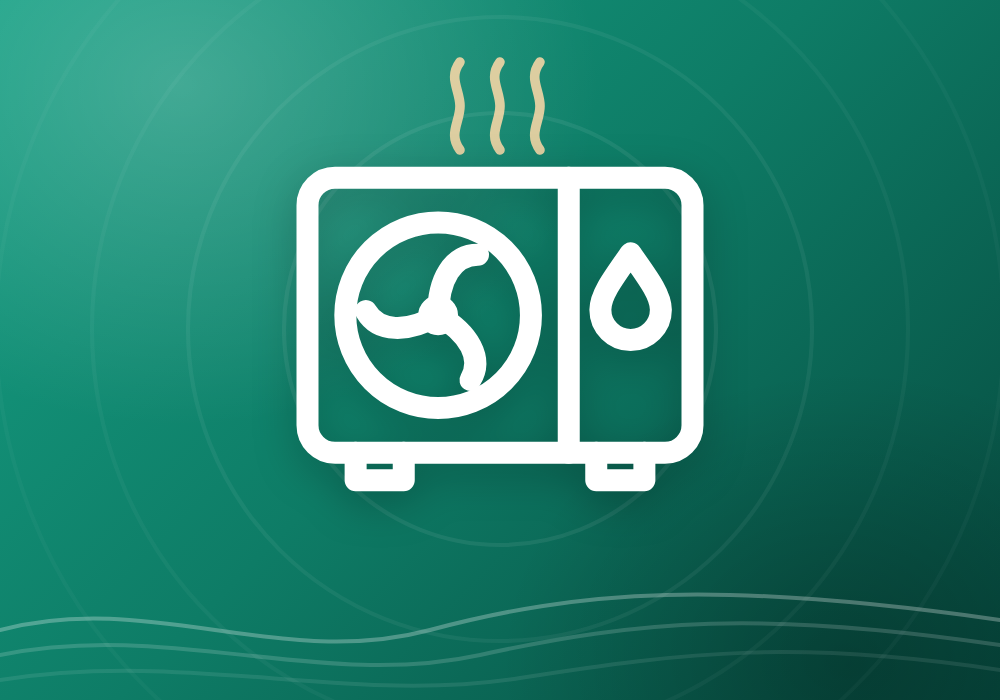
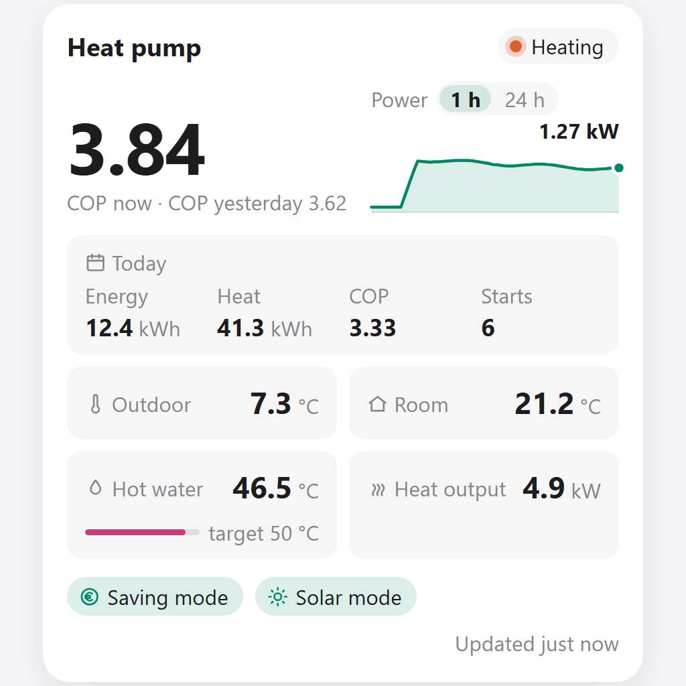
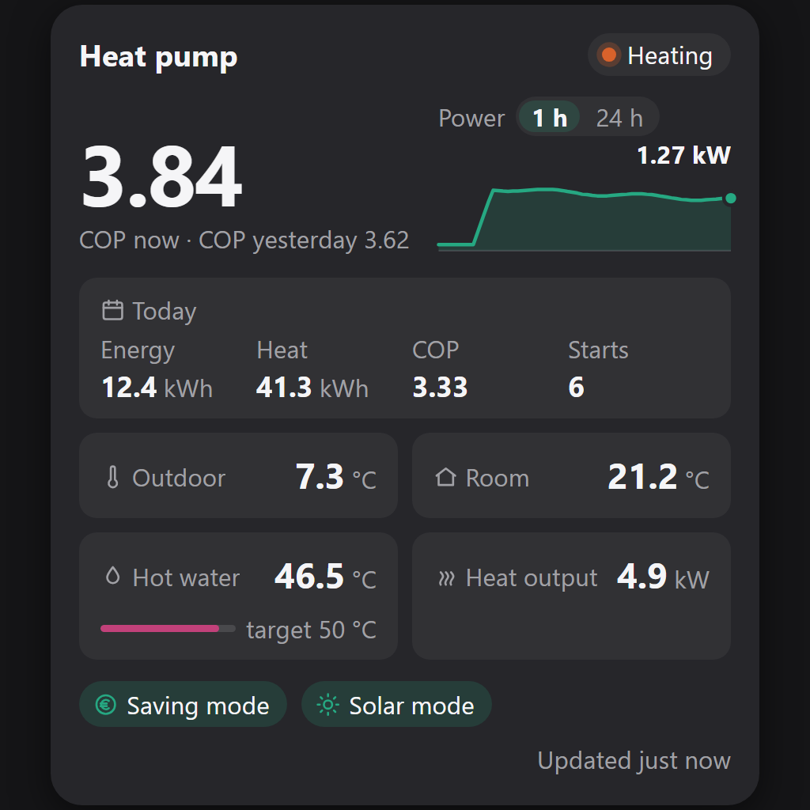

# MelPump for Homey

Monitor and control your heat pump from Homey Pro through [MelPump](https://melpump.com): live temperatures, COP and energy, Smart Energy (dynamic pricing) and solar mode, alarms, and Flow cards for automating your heating around electricity prices and solar production.

**App ID:** `io.github.marlark.melpump` · **SDK:** Homey Apps SDK v3 · **Homey:** Homey Pro, firmware ≥ 12.1.0 · **License:** MIT · **Languages:** English, Nederlands, Svenska, Deutsch, Dansk, Norsk

---

## Contents

- [What is MelPump?](#what-is-melpump)
- [Requirements](#requirements)
- [Getting started](#getting-started)
- [Device capabilities](#device-capabilities)
- [Flow cards](#flow-cards)
- [Flow recipes](#flow-recipes)
- [Dashboard widget](#dashboard-widget)
- [Homey Energy](#homey-energy)
- [Device settings](#device-settings)
- [How data is fetched](#how-data-is-fetched)
- [Good to know](#good-to-know)
- [Troubleshooting](#troubleshooting)
- [API reference](#api-reference)
- [Development](#development)
- [Translations](#translations)
- [Disclaimer](#disclaimer)
- [License](#license)

## What is MelPump?

[MelPump](https://melpump.com) is a cloud service for heat pumps. It connects to your heat pump through the manufacturer's cloud (for example MELCloud) or a local WiFi adapter, and adds analytics, Smart Energy mode (shifting heating to cheap electricity hours), solar surplus mode and alarms.

This app brings that data and control into Homey using the [MelPump API](https://melpump.com/api/doc). Homey talks to MelPump's cloud; it does not connect to the heat pump directly.

## Requirements

- Homey Pro with firmware 12.1.0 or later (needed for the dashboard widget)
- A [MelPump](https://melpump.com) account with your heat pump connected
- A MelPump **API token**. API access is limited to devices with an active MelPump subscription.

## Getting started

1. **Create an API token.** Log in at melpump.com, open **Account Settings → API Tokens** and create a token. Tokens start with `api_`.
   Give the token write access if you want to control the heat pump from Homey; a read-only token only shows data.
2. **Add the device.** In the Homey app, go to **Devices → + → MelPump → Heat Pump**, paste the token and choose your heat pump(s).
3. **Done.** Values appear within a minute. Yesterday's energy figures and the 30-day SCOP are fetched right away; the energy meter starts counting from the moment you add the device.

**Changing the token later:** if the token is revoked or you create a new one, open the device, then **Settings → Repair**, and paste the new token. The device keeps its history and Flows. The new token must belong to an account that has access to the same heat pump.

## Device capabilities

### Temperatures

| Capability | Source in the MelPump API |
|---|---|
| Room temperature, target temperature (zone 1, adjustable 10–30 °C) | `RoomTemperatureZone1`, `SetTemperatureZone1` |
| Outdoor temperature | `OutdoorTemperature` |
| Tank water temperature, target hot water temperature (adjustable 30–80 °C) | `TankWaterTemperature`, `SetTankWaterTemperature` |
| Flow and return temperature | `FlowTemperature`, `ReturnTemperature` |
| Flow/return difference (ΔT) | Flow minus return: how much heat the water gives off. A small ΔT while heating often means too high a flow rate. |
| Target flow temperature | `TargetHCTemperatureZone1` |
| Average outdoor temperature yesterday | daily energy report |

### Performance and energy

| Capability | Notes |
|---|---|
| COP | Live estimate. Keeps the last value while the compressor is stopped. |
| Power (estimated) | Electrical input power, used by Homey Energy |
| Energy used | Cumulative kWh meter for Homey Energy, see [Homey Energy](#homey-energy) |
| Heat output | Estimated heat delivered right now |
| Heat produced yesterday, COP yesterday | From MelPump's daily report |
| COP heating yesterday, COP hot water yesterday | Heating and hot water separately |
| Energy heating / hot water yesterday | kWh used for heating and for hot water |
| Heat produced for heating / hot water yesterday | kWh of heat delivered for each |
| Energy cooling, cooling produced, COP cooling yesterday | Only for heat pumps that can cool |
| Energy, heat produced and COP this month / last month / this year | Completed days; see [How data is fetched](#how-data-is-fetched) |
| SCOP last 30 days | Seasonal COP over the last 30 completed days |
| Compressor frequency, flow rate | |
| Compressor starts today / yesterday | Many short starts point to short cycling. After a restart, today is recalculated from MelPump's history (see below). |
| Compressor running today / yesterday | Hours the compressor has been running |
| Average compressor run today | Running time per start, in minutes. Short runs mean short cycling. |
| Defrosts today, defrost time today | Number of defrost cycles and total minutes |
| Immersion heater / booster heater on today | Minutes the direct electric heaters have been on: the most expensive heat |

### Smart Energy (saving mode) and solar mode

| Capability | Notes |
|---|---|
| Saving mode / solar mode today and yesterday | Hours the mode has been running |
| Energy in saving mode / solar mode today and yesterday | kWh used while the mode was running |
| Share in saving mode / solar mode yesterday | Share of yesterday's consumption that ran in that mode |
| COP in saving mode / solar mode / normal mode yesterday | Compare efficiency in each mode; normal = neither saving nor solar mode |
| Solar mode forced until | End time of solar mode forced from Homey, or *Not forced* |

These figures are measured by the app from the live readings, because MelPump's history doesn't say when these modes were running. They only cover time when the app was running, and the modes themselves are checked every 5 minutes and just after every full hour. When saving and solar mode run at the same time, that time counts for both.

### Status

| Capability | Notes |
|---|---|
| Operating mode | Auto, heating, cooling or off. Can be changed from Homey. |
| Current activity | Off, standby, heating, cooling, hot water, defrost or legionella protection |
| Zone 1 heating/cooling | Whether the zone is calling for heat or cooling right now |
| Zone 1 mode | How the zone is controlled: room control, heat curve, online curve, constant flow, pool or a cooling mode. Added when the heat pump reports it. |
| Saving mode (dynamic pricing) | Smart Energy is currently adjusting the heat pump |
| Night mode | Night mode is currently running and adjusting the heat pump |
| Solar mode | Solar mode is currently running |
| Summer eco | Summer eco is currently running and adjusting the heat pump |
| Defrosting, immersion heater, booster heater | |
| Heat pump error | Homey's standard alarm, with the error code in the Flow trigger |
| Last MelPump alarm, MelPump alarms today, unacknowledged MelPump alarms | Time and text of the newest alarm, today's count and how many are not acknowledged (checked every 15 minutes) |
| Last data from heat pump | When MelPump last received fresh readings |

### Toggles

| Capability | Notes |
|---|---|
| Smart Energy, night mode, summer eco on/off | Switch the function on or off from the device page. Shows the state reported by MelPump. |
| Holiday mode, quiet mode | Switch on or off from the device page. The API doesn't report these, so the toggle shows what was last set from Homey; changes made in the MelPump app aren't reflected. |
| Holiday mode until | When holiday mode set with *Turn on holiday mode until* ends, or *No end time* |
| Last legionella run | Date and time of the last legionella cycle |

### Added automatically when your heat pump has them

| Capability | When |
|---|---|
| Zone 2: room temperature, target temperature, flow temperature, target flow temperature, heating/cooling, mode | The heat pump reports an active zone 2 |
| Condensing temperature, mixing tank temperature | The heat pump reports a value for them |
| Flow and return temperature per zone, and their difference (ΔT) per zone | The heat pump reports both temperatures of the zone |
| Boiler flow and return temperature | Installations with a boiler that report them |
| Fan speed (and fan speed 2) | The first time the fan runs |
| Brine in / brine out temperature | Ground source heat pumps |

## Flow cards

### Triggers (When…)

| Card | Tokens |
|---|---|
| COP changed | COP |
| Saving mode activated | |
| Saving mode deactivated | |
| Smart Energy switched on / off (the function itself, e.g. in the MelPump app) | |
| Solar mode started / stopped | |
| Forced solar mode has ended (solar mode forced from Homey reached its end time) | |
| *Solar function* was switched *on/off* (solar mode for hot water, zone 1 or zone 2) | |
| Night mode activated / deactivated | Ends at (activated) |
| Summer eco activated / deactivated | |
| Compressor started | Starts today |
| Compressor stopped | Run time (minutes) |
| Hot water temperature fell below / rose above *x* °C | Temperature |
| Hot water is ready (tank within 1 °C of its target; again only after hot water was used, 5 °C below) | Temperature, target temperature |
| Compressor started *x* times within an hour (short cycling) | Starts in the last hour, average run today |
| *Immersion heater / booster heater / either* has been on for *x* minutes | Minutes |
| Room temperature zone *1/2* is *below / above / either* its target by *x* °C for *y* minutes (up to 180) | Temperature, target temperature, difference |
| Target flow temperature changed | Target flow temperature |
| Heat pump reports an error | Error code |
| New MelPump alarm (e.g. short cycling, low COP, device offline) | Alarm id, type, name, message, measured value |
| New MelPump alarm of a chosen type (18 types, e.g. short cycling, low COP, hot water temperature, energy cost) | Alarm id, message, measured value |
| Legionella run completed | Time |
| MelPump mode changed (auto, heating, cooling, off) | New mode, previous mode |
| Operation changed (e.g. heating → hot water or defrost) | New operation, previous operation |
| Mode of zone *1 / 2 / any* changed (e.g. room control → heat curve) | Zone, new mode, previous mode |

Homey's standard cards for the system capabilities (temperatures, target temperature, power, error alarm) are available as well.

### Conditions (And…)

- COP is / isn't above *x*
- Zone *1/2* is / isn't heating or cooling
- Mode of zone *1/2* is / isn't *mode*
- *Function* is / isn't on: Smart Energy, night mode, summer eco, solar mode (hot water, zone 1, zone 2)
- Saving mode / solar mode is / isn't active
- Night mode / summer eco is / isn't running
- Compressor is / isn't running
- There are / are no unacknowledged MelPump alarms
- Hot water temperature is / isn't above *x* °C
- Hot water is / isn't ready (within 1 °C of its target)
- Is / isn't defrosting
- Immersion heater / booster heater is / isn't on

### Actions (Then…)

| Card | What it does |
|---|---|
| Set MelPump mode | Auto, heating, cooling or off |
| Turn saving mode on or off | Saving mode = MelPump's Smart Energy |
| Turn a function on or off | Holiday mode, quiet mode, forced hot water, Smart Energy, night mode, summer eco, eco hot water, solar mode for hot water / zone 1 / zone 2 |
| Block or allow | Hot water, heating zone 1/2, cooling zone 1/2 |
| Force solar mode for *x* minutes / Stop solar mode | 1–1440 minutes |
| Force solar mode until a time | E.g. until 16:00; a time that has passed today means tomorrow |
| Set hot water temperature | 30–80 °C |
| Apply temperature preset | Away, Home or Boost, using the temperatures configured in MelPump |
| Apply hot water preset | Eco, Comfort or Hot, using the tank temperatures configured in MelPump |
| Boost hot water for at most *x* minutes | Forced hot water, switched off again by the app when the hot water is ready or the time is up (5–240 minutes) |
| Turn on holiday mode until *date* at *time* | The app switches holiday mode off at that moment, in the heat pump's time zone. Switching holiday mode off earlier cancels it. |
| Adjust heat curve | Shift the online heat curve −10 to +10 for zone 1 or 2 |
| Set flow temperature | Heating 10–80 °C or cooling 5–25 °C, per zone |
| Set zone control mode | Room control, heat curve, online curve, constant flow, pool and cooling modes |
| Acknowledge a MelPump alarm / all alarms | Use the *Alarm id* token from the alarm trigger |

> **Note:** *Adjust heat curve* only has an effect in Online Curve mode, and *Set flow temperature* only in Constant Flow / Cooling Flow mode. Only use *Set zone control mode* if you know which mode your installation is designed for.

## Flow recipes

Ready-made ideas to start from. *Italic* cards come from other apps or Homey itself.

**Hot water when electricity is cheap**
- *When* *the electricity price is among the cheapest hours of the day* (from your energy price app)
- *Then* MelPump: Boost hot water for at most 60 minutes

Add a second Flow that blocks hot water when the price is high (MelPump: Block hot water) and allows it again when it drops (MelPump: Allow hot water).

**Use solar surplus**
- *When* *your solar inverter produces more than 3000 W*
- *And* MelPump: Solar mode isn't active
- *Then* MelPump: Force solar mode for 60 minutes

**Warn about short cycling**
- *When* MelPump: Compressor started 6 times within an hour
- *Then* *Send a push notification*: "Heat pump short cycling: [Starts in the last hour] starts, average run [Average run today] min"

**Warn about expensive electric heat**
- *When* MelPump: Immersion heater or booster heater has been on for 60 minutes
- *Then* *Send a push notification*: "The electric heater has been on for an hour"

**Tell when the shower is ready**
- *When* MelPump: Hot water is ready
- *And* *the time is between 06:00 and 08:00*
- *Then* *Speak*: "The hot water is ready"

**Notice before it gets cold**
- *When* MelPump: Room temperature zone 1 is below its target by 1.5 °C for 60 minutes
- *Then* *Send a push notification*: "Living room is [Temperature] °C, target [Target temperature] °C"

**Away and holiday**
- *When* *the last person leaves home* *Then* MelPump: Apply temperature preset Away
- *When* *the first person comes home* *Then* MelPump: Apply temperature preset Home
- Before a trip: MelPump: Turn on holiday mode until *the day you return*, at a time that leaves the house warm when you arrive

**Night mode reminder**
- *When* MelPump: Night mode activated
- *Then* *Write to the timeline*: "Night mode until [Ends at]"

## Dashboard widget

Add the **MelPump status** widget to a Homey dashboard to see a heat pump at a glance:

- **COP** now and yesterday, and what the heat pump is doing.
- **Power graph** for the last hour or the last 24 hours (switch with *1 h / 24 h*; touch or hover to read a moment). After the app starts, the hour graph fills within an hour; the day graph is filled from midnight with MelPump's history and continues from there.
- **Today:** energy used, heat produced, COP and compressor starts.
- **Temperatures:** outdoor, room and hot water (with a bar from cold water to the target temperature), and heat output.
- **Modes** that are running: saving, solar, night, summer eco, defrost.
- **Warnings and alarms:** a yellow bar when the heat pump is offline, the subscription is inactive or there is no data; a red bar with unacknowledged alarms and the latest one, with an *Acknowledge* button.
- **Data age:** "Updated 2 min ago", turning into a warning when there has been no new data for over 5 minutes.

The widget updates right after each poll (every minute), so it shows the same as the device.

**Widget settings:** the heat pump (with only one you can leave it empty), *Full* or *Compact* layout (header, COP and power, warnings, modes and buttons), and whether to show today's figures and the temperatures.

**Quick buttons** (off by default): hot water *Hot* / *Comfort* (the temperatures set in MelPump), solar mode for 1 hour, and saving mode on / off. Tap once, then again within 4 seconds to confirm. Buttons need a token with write access and are hidden without it.

| Light | Dark |
|---|---|
|  |  |

## Homey Energy

MelPump publishes energy consumption **per completed day**: today's figure is never available until the day is over. To keep Homey Energy up to date anyway, the *Energy used* meter combines three sources:

1. **Completed days:** MelPump's reported daily totals, added as soon as they are published (usually shortly after midnight).
2. **Today:** the live power reading, every minute.
3. **After a gap in those readings** (Homey or the app restarted, the heat pump sent no data, MelPump couldn't be reached): today's figure is recalculated from MelPump's 5-minute state history at the next hourly energy check, so nothing is missed.

The same history also recalculates today's heat produced, compressor starts and running hours, and defrosts, and fills the widget's 24-hour graph from midnight, all without extra requests. The history has a reading every 5 minutes, so it can miss runs and defrosts shorter than that; for those figures the app keeps the higher of its own count (every minute) and the history's.

The meter never goes backwards, as Homey Energy requires. If the estimate for a day turns out higher than MelPump's final figure, the meter pauses until the real totals catch up. Power is marked as *approximated* in Homey Energy because it is MelPump's estimate.

## Device settings

- **Shown on the device:** hide groups of values you don't need: toggles, saving / solar mode statistics, compressor and defrost statistics, heating and hot water separately, month and year, and alarm details. Compressor and defrost statistics and heating and hot water separately are off by default for newly added heat pumps. Hidden values are removed from the device, including their Insights history, and come back (filled at the next update) when you turn the group on again.
- **Notifications:** turn Homey timeline notifications for new MelPump alarms (on by default) and for saving mode and solar mode starting / stopping (off by default) on or off.
- **Night mode and summer eco (from MelPump):** read-only: when night mode runs and its temperatures, and the summer eco schedule.
- **Solar mode (from MelPump):** read-only: the maximum hours of solar mode per day, the preferred hour, the temperatures solar mode raises hot water and the zones to, and the solar panel power configured in MelPump.
- **Installation (from MelPump):** read-only information about the heat pump: model, serial number, heating power, heated area, heat distribution (radiators / underfloor) and connection type.
- **Diagnostics:** read-only: last data from the heat pump, last successful update, requests to melpump.com in the last hour and the last error. Updated every 5 minutes and on errors. Useful when reporting a problem.

## How data is fetched

The MelPump API allows **100 requests per hour per device**. The app stays well below that:

| Data | Interval | Requests/hour |
|---|---|---|
| Live state | every minute | 60 |
| Device details and settings | every 5 minutes, plus just after each full hour and after a Flow changes a function or solar mode | 12–13 |
| Alarms | every 15 minutes | 4 |
| Energy (daily totals, and today's history after a gap in the live readings) | every hour | 1–2 |
| Subscription status and token access | every 6 hours, and at once when MelPump refuses access | < 1 |
| Month and year totals | once a day (completed months are cached; filling the cache after pairing takes a few hours) | ~1 |

That is about 75–80 requests per hour, which leaves room for changes made from Homey. After Homey restarts, each heat pump makes its first (largest) poll within 20 seconds, spread out instead of all at once. The app also counts its own requests: above 90 in the last hour (e.g. when many Flows change settings), it skips reads until there is room again, so changes from Homey still get through. If MelPump ever answers with *Too Many Requests*, the app pauses for 10 minutes. While the heat pump is offline, only the device details are checked (12 requests/hour).

When melpump.com can't be reached, the app retries once after a minute and then waits longer between attempts (2, 5 and at most 10 minutes), returning to every minute as soon as MelPump answers. After a change from Homey, the next update comes within about 20 seconds, so you see what the heat pump did with it. Temperature sliders send only the value you end on, not every step while dragging.

## Good to know

- **Operating mode can be set but not always read back.** The API only reports whether the heat pump is on or off. For heat pumps without cooling the picker offers just *Heating* and *Off*, so it always shows the right mode (a Flow choosing *Auto* sets *Heating*). For heat pumps that can cool, the API doesn't report which of auto/heating/cooling is configured, so the picker shows what was last set from Homey (and *Off* when the heat pump is switched off). Use *Current activity* to see what the heat pump is actually doing.
- **COP is held while idle.** MelPump reports COP 0 when the compressor stops; the app keeps the last real value so Insights and the *COP changed* trigger aren't flooded with zeros.
- **Tiny changes are skipped.** Power and heat output update when they change by at least 10 W, COP by 0.05, flow rate by 0.1 and the flow/return difference by 0.2 °C (going to or from 0 always shows). This keeps Insights and Homey from being written to every minute for changes nobody can see; the energy meter and statistics still use every reading.
- **"Standby" vs "Off".** MelPump reports the same activity code for an idle and a switched-off heat pump; the app shows *Off* only when the heat pump is actually switched off.
- **Holiday mode, quiet mode and forced hot water can be set but not read back.** MelPump's API has no status for them, so there are no conditions for them and the holiday / quiet toggles show what was last set from Homey. The end of a hot water boost or of *holiday mode until* is switched by the app (the end time is kept across restarts); if Homey is off at that moment, it happens at the first poll after Homey is back.
- **The device adapts to your heat pump.** If MelPump reports that the heat pump can't cool, the cooling values and the *Cooling* mode are left out, and Flow cards asking for cooling stop with a clear message. Without a room thermostat, room temperature and target temperature are left out.
- **Estimated days are refreshed.** When MelPump marks yesterday's figures as an estimate, the app shows them but fetches them again every hour until the final figures are in.
- **Month and year count completed days.** Today is added once the day is over, like the other daily figures.
- **Values are MelPump's estimates.** Power, heat output and COP are estimated by MelPump, not measured by a meter.
- **The MelPump API is under active development.** Fields may change; please [open an issue](../../issues) if a value looks wrong.

## Troubleshooting

| You see | What to do |
|---|---|
| *melpump.com rejected the API token* | The token was revoked or has expired. Create a new one and use **Repair**. |
| *Your API token only has read access* | Create a token with write access and use **Repair**. |
| Warning *The heat pump is offline according to MelPump* | MelPump hasn't received data from the heat pump recently. The device stays available with its last values; check the heat pump's internet connection. |
| Warning *MelPump has lost its connection to the heat pump's cloud service* | Reconnect the integration (e.g. MELCloud) in the MelPump app. |
| Warning *The MelPump subscription for this heat pump is not active* | The MelPump API only works with an active subscription. Renew it in your MelPump account. |
| Warning *MelPump currently receives no data* | Values shown may be out of date; they update again automatically. |
| A sensor you expected is missing | Optional sensors only appear once the heat pump reports a value for them. |

## API reference

The MelPump API is documented at [melpump.com/api/doc](https://melpump.com/api/doc) (OpenAPI spec: [`/api/doc.json`](https://melpump.com/api/doc.json)). Every API call is in [`lib/melpump_api.js`](lib/melpump_api.js); the mapping from API fields to Homey capabilities is in `applyState()` in [`drivers/heatpump/device.js`](drivers/heatpump/device.js).

## Development

The app uses [Homey Compose](https://apps.developer.homey.app/advanced/homey-compose): `app.json` is generated, so don't edit it directly. Edit these files instead:

| What | Where |
|---|---|
| App name, description, permissions, images | `.homeycompose/app.json` |
| Custom capabilities | `.homeycompose/capabilities/<id>.json` |
| Driver (class, capabilities, pairing) | `drivers/heatpump/driver.compose.json` |
| Device settings | `drivers/heatpump/driver.settings.compose.json` |
| Flow cards (the device argument is added automatically) | `drivers/heatpump/driver.flow.compose.json` |
| Dashboard widget | `widgets/status/widget.compose.json` |

`homey app build`, `homey app run`, `homey app install` and `homey app validate` regenerate `app.json`.

**Tests:** `npm test` checks the translations (see below) and runs the unit tests in `test/` with Node's built-in test runner (Node 22 or later, no packages needed). `npm run test:unit` runs only the unit tests. They use a stand-in for the Homey SDK (`test/helpers.js`) and a local server instead of melpump.com, and cover the API client, polling and back-off, statistics, solar mode, energy and month / year totals, capability groups and features, the widget, and debug logging. GitHub Actions runs `npm test` and `homey app validate --level publish` on every push and pull request.

**Debug logging:** with `homey app run` (which sets `DEBUG=1`), the app also logs, marked `[debug]`, every request to melpump.com (method, path, body, status, time and size; never the token), a summary of every poll, every changed value, every trigger with its tokens, every Flow action with its arguments, changes made from Homey and settings changes. An app installed with `homey app install` doesn't log these.

## Translations

All texts exist in English, Dutch, Swedish, German, Danish and Norwegian: user-facing strings in `locales/*.json`, capability, setting and Flow card titles in the Homey Compose files, and the store description in `README.txt` / `README.<lang>.txt`. When adding a text, add all six languages.

`npm test` checks this: every text in all six languages, the same Flow card placeholders (`[[arg]]`) in every language, the same keys in every `locales/*.json`, every key used in the code present, the changelog and the store texts. Unit symbols such as °C and kWh may be given in English only.

The German, Danish and Norwegian translations are new; corrections from native speakers are very welcome.

**Want the app in another language?** [Open a feature request](../../issues/new) with the language you'd like added.

## Disclaimer

This is an unofficial, community-made app. It is not developed, endorsed, supported or maintained by MelPump (melpump.com), and MelPump is not responsible for the app or for any issues caused by using it. Please report problems with the app here on GitHub, not to MelPump support. "MelPump" is used only to describe the service the app connects to.

This app is also not endorsed, verified or approved by Mitsubishi Electric Corporation or any other heat pump manufacturer. Product names are used only to describe compatibility. Changing heat pump settings from automations is at your own risk; check your installation's documentation before using the heat curve, flow temperature and zone mode actions.

## License

[MIT](LICENSE)
